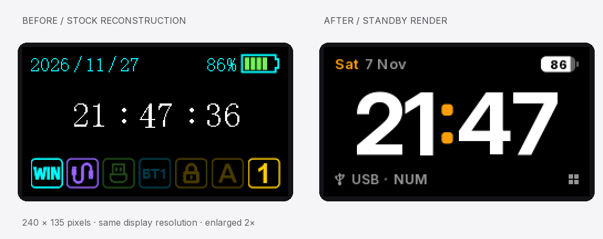
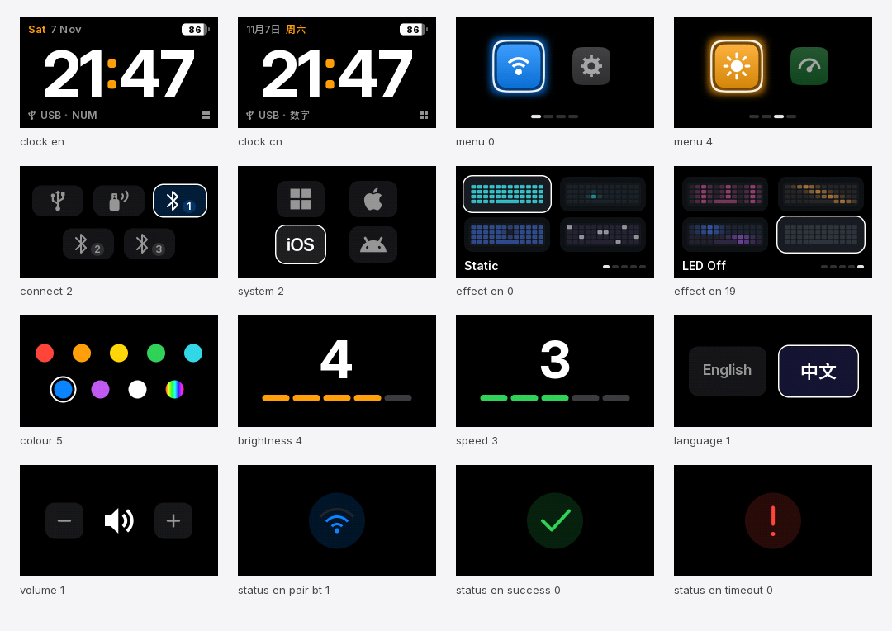

# Standby UI for AULA F108 Pro

A complete screen redesign for the AULA F108 Pro: a large, legible clock, square icon menus, segmented navigation, and focused controls in English and 中文.

**Experimental hardware project.** The UI has run on one keyboard; the latest Effect mapping and Connection flicker fixes still need final physical confirmation. This is an independent community project.

[Interactive preview](https://azizerorahman.github.io/aula-f108pro-standby-ui/) · [中文](README.zh-CN.md) · [Installation](docs/INSTALLATION.md) · [Compatibility](docs/COMPATIBILITY.md)



The comparison uses a **reconstruction of the stock screen** and the **new UI render**, enlarged by the same amount. These are screen assets, not device photographs. The stock reconstruction uses community reference graphics and is not evidence that every regional variant has the same layout.

## What is included

- Large Inter clock numerals, a blinking orange colon, and English/Chinese dates.
- Icon-only square menus with a focus ring and four navigation segments.
- Centred Connection and System selectors; Bluetooth channel badges.
- Brightness, Speed, Colour, Volume and Language controls.
- Twenty lighting choices in native order: **Static first, LED Off last**.
- Icon-only pairing and result screens, plus an unbranded boot animation.
- Portable Python artwork source, 134 native-size PNGs, a browser preview, firmware patches, and Windows transport source.



Lighting thumbnails illustrate patterns; they are not recordings of the keyboard. Volume shows quieter/louder actions, not an unverified system-volume percentage.

## Try the design

Open [the interactive preview](https://azizerorahman.github.io/aula-f108pro-standby-ui/), or download this repository and open `docs/index.html`. The preview works offline and sends no device commands.

To regenerate the artwork:

```sh
python -m venv .venv
# Activate the environment using the command for your shell.
python -m pip install -r requirements.txt
python tools/render_ui.py
python tools/build_preview.py
python -m unittest discover -s tests -v
python tools/check_project.py
```

Generated artwork goes into `build/rendered/`. The checked-in native assets remain the reviewed reference.

## Firmware and installation

The reference build targets the **SN32F290 Chinese 1.07 firmware binary**, identified by its exact SHA-256. Regional releases and USB revision numbers are not interchangeable compatibility guarantees.

Vendor firmware and complete patched MCU binaries are **not distributed**. Obtain the stock binary separately, then build locally:

```sh
python tools/build_firmware.py --base /path/to/SN32F290_CH.bin
```

This produces the two matching payloads under `dist/`, without opening the keyboard. Read [installation](docs/INSTALLATION.md) before using the Windows transport. Its default `Verify` mode uses mocked device I/O. The public wrapper currently accepts revision **0107** only; it does not provide an unattended upgrade path for other revisions.

## Project status

| Area | Status |
| --- | --- |
| UI source, 134 screens and offline preview | Included |
| Reference firmware and graphics reproduction | Exact hashes verified locally |
| Live clock and menus on development hardware | Observed |
| Latest LED Off/effect correspondence | Offline tests passed; final hardware check pending |
| Connection flicker fix | Black clear removed; final hardware check pending |
| Broad hardware/region compatibility | Not established |
| Custom information dashboard | Proposal; not implemented |

Historical offline checks covered asynchronous LCD transfers, knob input, lighting initializers and transport failures. Their scope and limits are documented in [validation](docs/VALIDATION.md); these are not a claim of complete hardware certification.

## Repository map

```text
assets/             Native screens, fonts, icons and lossless graphics atlas
src/standby_ui/      Portable drawing, clock, effects and RGB565 utilities
src/transport/      Windows HID transport source
firmware/           Reviewed byte patches, sprite map and assembly references
tools/              Artwork, preview, build, validation and installation commands
tests/              Offline asset, patch and renderer regression tests
docs/               Preview, comparison images and engineering documentation
LICENSES/           Third-party license notices
```

## Contributing

Start with [CONTRIBUTING.md](CONTRIBUTING.md). Useful next contributions include a full physical effect sweep, reconnect-persistence checks, additional hardware variants, and a companion protocol for an optional information page.

Please keep credentials, private device identifiers, recordings and vendor binaries out of pull requests. See [the privacy policy](docs/PRIVACY.md).

## Credits and licensing

Original project code and artwork are MIT-licensed, except where [third-party notices](THIRD_PARTY_NOTICES.md) specify otherwise. Inter and Noto Sans SC retain their SIL Open Font License; platform icons retain their upstream notices.

Protocol research builds on [AuRoN89's reverse-engineering work](https://github.com/AuRoN89/AULA-F108-PRO-Reverse-Engineering) and [Parsiya's F108 Pro research](https://github.com/parsiya/f108-pro). The stock comparison image and adapted transport carry the applicable CC BY 4.0 attribution. AULA and platform names/marks belong to their respective owners; no endorsement is implied.
