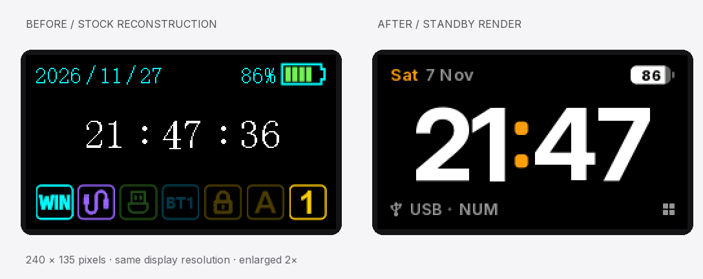

# AULA F108 Pro · Standby UI

面向键盘 240 × 135 屏幕的完整界面重设计：大号时钟、方形图标、分段导航，以及英文和中文界面。

[交互预览](https://azizerorahman.github.io/aula-f108pro-standby-ui/) · [English](README.md) · [安装说明](docs/INSTALLATION.md)

对比图左侧为基于社区参考资料重建的原厂界面，右侧为新版设计渲染；二者均按相同倍率放大，并非设备实拍。

本项目处于实验阶段，已在一台开发设备上运行。最新灯效对应关系、LED Off 和 Connection 闪烁修正仍待最终实机验收，不代表所有硬件版本均兼容。

仓库包含可移植绘图源码、134 张原生尺寸界面、离线网页预览、固件补丁和 Windows 传输源码。不包含账号凭据、私人设备记录、原始视频或厂商固件二进制文件。

先安装 `requirements.txt`，运行 `python tools/render_ui.py` 生成界面。固件构建需自行提供指定 SHA-256 的中文 1.07 原厂 `.bin`；公开安装入口仅接受 USB revision 0107。完整操作边界见英文安装说明。恢复出厂设置不会重新写入屏幕资源。

原创代码及素材使用 MIT 许可证；字体、平台图标、参考重建图和改编传输代码遵循 [第三方说明](THIRD_PARTY_NOTICES.md)。自定义信息页仍是提案，尚未实现。
